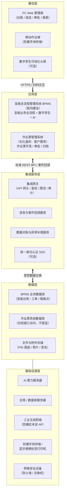
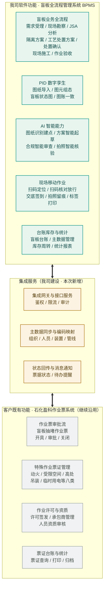
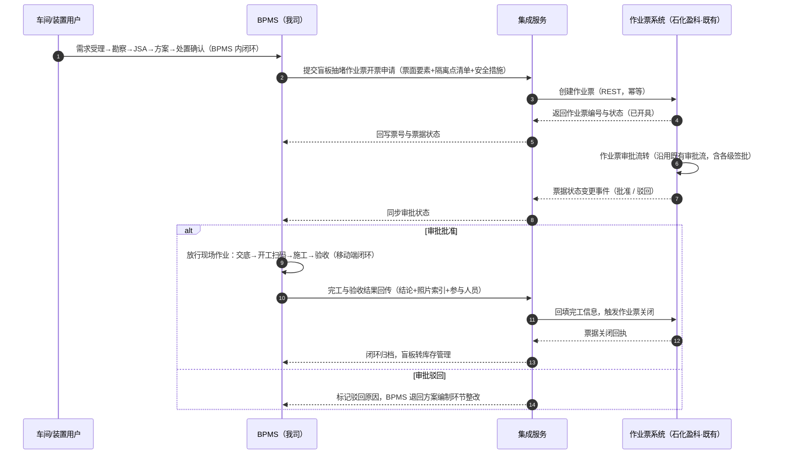

# 盲板全流程管理系统（BPMS）与既有作业票系统共存集成方案

| 项目 | 内容 |
| --- | --- |
| 方案名称 | 盲板全流程管理系统（BPMS）与石化盈科作业票系统共存集成方案 |
| 方案版本 | V1.0 |
| 编制日期 | 2026 年 9 月 |
| 编制单位 | 盲板全流程管理系统（BPMS）项目组 |
| 适用场景 | 项目立项评审、技术交流、商务洽谈 |

> **文档说明**：本方案中的架构图、功能架构图与业务协同时序图均采用 Mermaid 矢量图描述。在支持 Mermaid 的查看器（GitHub、GitLab、Typora、VS Code、语雀、Confluence 等）中可自动渲染为可缩放的矢量图形；纯文本环境下亦可直接阅读图中的结构化文字描述。

---

## 第一章 项目概述

### 1.1 项目背景

客户已建成石化盈科作业票系统，覆盖动火、受限空间、高处作业、吊装、临时用电等特殊作业票证的开具、审批与归档管理，系统运行稳定、用户习惯已经养成。盲板抽堵作业作为装置开停车与检维修期间最高频、风险最高的特殊作业之一，其**作业票审批环节继续保留在客户既有作业票系统中执行**，不重复建设、不替代、不改变用户既有审批习惯。

与此同时，盲板管理本身存在大量作业票系统无法覆盖的专业业务：盲板台账与基础主数据维护、PID 图纸数字孪生、现场勘察与隔离点定位、JSA 分析、隔离方案与工艺处置方案编制审批、现场施工过程管控（扫码核对、拍照留痕、电子签名）、作业验收以及盲板库存周转管理等。上述业务正是我司盲板全流程管理系统（BPMS）的专业能力所在。

因此，本方案定位为**共存集成方案**：作业票审批沿用石化盈科作业票系统，我方 BPMS 聚焦盲板业务全流程数字化，两系统通过标准接口协同工作，共同构成完整的盲板抽堵作业安全管理闭环。

### 1.2 建设目标

1. **业务闭环不断点**：盲板业务从需求提出到验收归档全程线上流转，其中作业票审批环节无缝衔接既有作业票系统，状态双向实时同步，杜绝线下传递与人工跟催。
2. **数据同源不落地**：作业票号、审批状态、人员资质、组织机构等关键数据在两系统间自动交换，避免二次录入与数据不一致。
3. **职责边界清晰**：两系统功能分工明确、接口责任清晰，为项目实施、验收与后续运维提供无歧义的依据。
4. **投资经济合理**：不改造、不升级客户既有作业票系统，集成改造工作量与投资集中于我方系统侧，保护客户既有 IT 投资。

### 1.3 集成原则

| 原则 | 说明 |
| --- | --- |
| 不改变既有系统 | 作业票系统侧仅做"接口开放"级别的最小配合（或经由集成中间服务适配），不做业务逻辑改造 |
| 松耦合 | 通过标准 REST API + 事件回调集成，两系统可独立升级部署，任一方短时不可用不影响另一方核心业务 |
| 标准协议 | 接口统一采用 HTTPS + RESTful + JSON，Token 鉴权，具备幂等性与失败重试机制 |
| 主数据统一 | 装置/单元/管线编码建立映射表，组织与人员以客户统一主数据或作业票系统为准，BPMS 定期同步 |
| 安全合规 | 遵循客户内网安全规范，接口经集成网关统一鉴权、限流、审计留痕 |
| 依据标准 | 盲板抽堵作业管理流程遵循 GB 30871—2022《危险化学品企业特殊作业安全规范》及客户作业票管理制度 |

---

## 第二章 系统整体架构

### 2.1 系统整体架构图（矢量图）

### 2.2 架构分层说明

**展现层**：面向三类终端。PC Web 管理端服务车间与职能处室用户，承载台账管理、PID 组态、方案审批与统计报表；移动作业端部署于防爆手持终端，服务现场作业人员与属地监护人，承载扫码核对、任务执行、拍照留痕与电子签名；可视化大屏为可选项，用于生产指挥中心展示全厂盲板状态与作业动态。

**应用层**：由两套独立系统构成。左侧为我司 BPMS，负责盲板业务全流程管理（需求受理 → 现场勘察 → JSA 分析 → 隔离方案 → 工艺处置方案 → 处置确认 → 现场施工 → 作业验收 → 库存周转）、PID 数字孪生与 AI 智能能力；右侧为客户既有石化盈科作业票系统，负责盲板抽堵作业票及各类特殊作业票的开具、审批、归档，该系统**继续按现状运行，本方案不涉及其业务功能改造**。

**集成服务层**：两系统之间的唯一合法通道。集成网关统一完成接口鉴权、流量控制与调用审计；消息回调服务承接作业票状态变更事件；数据对账服务按日核对两系统票据状态并提供差异补偿；统一身份认证（SSO）为可选项，用于实现一次登录、两端通行。

**数据层**：BPMS 业务数据库独立部署；作业票系统数据库归盈科系统所有，本方案**不直接访问其数据库**，一切数据交换均经由集成服务层接口完成，确保既有系统的数据安全边界不被破坏。

**基础设施层**：包括 AI 算力服务器（承载 PID 图纸识别、方案起草、合规审查等 AI 推理）、应用与数据库服务器、防爆区本安型工业无线 AP、防爆手持终端与蓝牙便携标签打印机等现场硬件，以及防火墙等网络安全设备。服务器侧资源可利旧客户虚拟化平台，或按第五章清单新购。

---

## 第三章 系统功能架构

### 3.1 功能架构图（矢量图）

下图中，**绿色区块为我司 BPMS 软件功能**，**灰色区块为客户既有石化盈科作业票系统功能**，**中部琥珀色区块为本次新建的集成服务**（我司建设）。

### 3.2 我司 BPMS 功能清单

| 功能域 | 功能要点 |
| --- | --- |
| 盲板业务全流程 | 作业需求受理、现场勘察（扫码加入隔离点、PID 图定位）、JSA 分析、隔离方案编制与审核、工艺处置方案编制与审核、处置确认、现场施工管控、作业验收，九大环节状态机管控、不可跳步 |
| PID 数字孪生 | PID 图纸导入与原图查看、图元组态与绑定主数据、装置归属管理、盲板状态图实时渲染、图纸=台账=现场三者一致 |
| AI 智能能力 | PID 图纸 AI 识别自动建点补建管线、隔离方案与工艺处置方案 AI 起草、作业合规 AI 审查、现场照片 AI 核验 |
| 现场移动作业 | 隔离点扫码定位、交底/开工/完工/验收四节点扫码核对（位置不符禁止作业）、人员扫码签到与人证核验、拍照录音留痕、盲板二维码标签蓝牙打印 |
| 台账库存与统计 | 盲板全生命周期台账、基础主数据（装置/单元/管线/隔离点/数据字典）管理、盲板库存与周转统计、多维报表 |

### 3.3 原作业票系统（石化盈科）保留功能

以下功能继续由客户既有作业票系统承担，**本方案不重复建设**：盲板抽堵作业票的开具、审批流转、批准/驳回/关闭；动火、受限空间、高处、吊装、临时用电等其他特殊作业票证管理；作业许可签发与票证归档台账；承包商单位与作业人员资质管理；气体检测记录管理等。

### 3.4 功能职责分工对照表

| 业务事项 | 责任系统 | 协同说明 |
| --- | --- | --- |
| 盲板需求/勘察/JSA/方案/处置确认 | **我司 BPMS** | BPMS 内部闭环完成 |
| 盲板抽堵作业票开具与审批 | **作业票系统（既有）** | BPMS 完成处置确认后发起开票申请，审批状态回传 BPMS |
| 现场交底/开工/施工/验收 | **我司 BPMS** | 以作业票"已批准"状态作为放行前置条件 |
| 作业人员资质审核与人证核验 | **双方协同** | 资质主数据以作业票系统/客户统一主数据为准，BPMS 移动端做人证比对与留痕 |
| 完工关闭作业票 | **双方协同** | BPMS 回传完工验收结果，作业票系统执行票据关闭归档 |
| 盲板台账/库存/数字孪生/AI | **我司 BPMS** | 独立建设 |
| 其他特殊作业票证（动火等八类） | **作业票系统（既有）** | 完全沿用，不集成不改造 |

---

## 第四章 系统集成方案

### 4.1 集成总体设计

两系统通过**集成服务层**点对点集成，不直接访问对方数据库。集成服务由我司建设并交付，支持两种部署形态：

1. **API 直连形态**（推荐）：BPMS 与作业票系统均开放 REST API，集成网关完成协议适配、鉴权、重试与审计。适用于盈科系统可开放接口的情况。
2. **中间适配形态**（备选）：若作业票系统暂不具备接口开放条件，可在集成服务中采用"视图中间库 / 定时文件交换"适配器过渡，接口层契约保持不变，后续平滑切换为 API 直连。

集成接口统一约定：HTTPS 传输、RESTful + JSON 报文、Token 鉴权（双向）、关键接口幂等设计（业务单号 + 幂等键）、失败自动重试（指数退避，最多 5 次）、全部调用留痕可审计。

### 4.2 核心业务协同时序（矢量图）

以盲板抽堵作业全生命周期为例，两系统协同时序如下：

上述时序中的关键控制点：**BPMS 以作业票"已批准"状态作为现场作业放行的硬性前置条件**，未获批准的工单在移动端不出现交底/开工入口；作业票关闭以 BPMS 回传的完工验收结果为触发依据，实现"业务驱动票证、票证约束业务"的双向闭环。

### 4.3 集成接口清单

| 编号 | 接口名称 | 方向 | 交互方式 | 主要内容 | 触发方式 / 频率 |
| --- | --- | --- | --- | --- | --- |
| IF-01 | 统一身份认证（可选） | 4A/作业票系统 → BPMS | REST | SSO 登录票据校验、用户身份映射 | 用户登录时 |
| IF-02 | 组织与人员同步 | 作业票系统 → BPMS | REST 增量 | 部门、岗位、人员、资质证书信息 | 每日增量 + 手动全量 |
| IF-03 | 装置主数据映射 | BPMS ↔ 作业票系统 | REST | 装置/单元/设备编码映射表登记与查询 | 实施期初始化 + 变更同步 |
| IF-04 | 开票申请 | BPMS → 作业票系统 | REST | 盲板抽堵作业票票面要素、隔离点清单、安全措施、附图索引 | 业务事件触发 |
| IF-05 | 票据状态回传 | 作业票系统 → BPMS | 事件回调 / 兜底轮询 | 已开具、审批中、批准、驳回、关闭状态及意见 | 事件驱动；10 分钟轮询兜底 |
| IF-06 | 完工结果回传 | BPMS → 作业票系统 | REST | 施工完成确认、验收结论、完工照片索引、参与人员 | 业务事件触发 |
| IF-07 | 消息与待办通知 | 双向 | Webhook | 待办提醒、超期预警、状态变更通知 | 事件驱动 |
| IF-08 | 数据对账 | 双向 | REST 批量 | 按日核对票据状态与业务单据，输出差异报告 | 每日凌晨定时 |

### 4.4 主数据与编码映射

盲板业务主数据（装置、单元、管线、盲板规格、隔离点）以 BPMS 为管理源头；作业票系统引用的装置/设备编码通过 IF-03 映射表与 BPMS 对齐，映射关系由实施阶段联合客户确认并固化，后续新增装置按管理流程同步维护。组织机构、人员与资质主数据以客户统一来源（4A 或作业票系统）为准，BPMS 通过 IF-02 定期同步，不在 BPMS 内重复维护。

### 4.5 异常处理与降级方案

| 异常场景 | 处置策略 |
| --- | --- |
| 作业票系统短时不可用 | BPMS 业务操作不受阻；开票申请进入待发送队列，恢复后自动续传并告警 |
| 接口调用失败 | 自动重试（指数退避 5 次）仍失败则转人工待办，界面醒目提示，支持手工重推 |
| 状态不一致 | IF-08 每日对账生成差异清单，管理员一键核对补偿；关键状态（批准/关闭）支持人工核对后修正 |
| 回调丢失 | 以 10 分钟轮询作为兜底对账机制，确保状态最终一致 |
| 极端情况降级 | 支持经客户审批后启用"离线作业 + 事后补录"应急预案，补录操作全程留痕 |

---

## 第五章 需要购买的软硬件设备

### 5.1 软硬件配置清单

| 序号 | 类别 | 名称 | 规格与主要技术要求 | 数量 | 用途说明 |
| --- | --- | --- | --- | --- | --- |
| 1 | 硬件 | 防爆手持终端 | 本安型防爆认证（Ex ib IIC T4 Gb），Android，≥6 英寸，支持一维/二维扫码头、NFC、≥1300 万像素自动对焦相机、IP68、Wi-Fi 6 + 5G，续航 ≥ 整班作业 | 10 台 | 现场勘察、扫码核对、交底签到、拍照留痕、移动审批 |
| 2 | 硬件 | 蓝牙便携标签打印机 | 热转印/热敏，打印分辨率 ≥203dpi，蓝牙 5.0，支持防水防油合成标签，单手可持，电池 ≥8 小时 | 4 台 | 现场打印盲板二维码标识标签 |
| 3 | 硬件 | AI 算力服务器 | 2×国产 AI 加速卡或同档 GPU（单卡算力 ≥200 TOPS 级），内存 ≥128GB，NVMe SSD ≥4TB，冗余电源 | 1 台 | PID 图纸识别、方案起草、合规审查、照片核验等 AI 推理 |
| 4 | 硬件 | 应用服务器 | 2×16 核 CPU，内存 ≥256GB，SSD RAID10，双电源 | 2 台 | BPMS 应用与集成服务部署（高可用） |
| 5 | 硬件 | 数据库服务器 | 2×16 核 CPU，内存 ≥128GB，SSD RAID10，双电源 | 1 台 | BPMS 业务数据库 |
| 6 | 硬件 | 工业无线 AP | Wi-Fi 6，IP67 及以上；防爆区域须本安认证并持有防爆合格证 | 8 台 | 装置现场无线网络覆盖（防爆区/非防爆区混合部署） |
| 7 | 硬件 | 交换机与网络安全设备 | 万兆核心交换机 1 台、千兆接入交换机 2 台、下一代防火墙 1 台、无线控制器 1 台 | 1 套 | 网络组网与边界安全 |
| 8 | 硬件 | 盲板二维码标识牌 | 316L 不锈钢蚀刻二维码，耐温防腐，含固定附件，规格 ≥60mm×60mm | 500 块 | 隔离点/盲板位永久标识，供扫码核对 |
| 9 | 硬件 | 手持终端充电柜 | 10 位智能充电柜，带充满自停与电量统计 | 1 套 | 防爆手持终端集中充电管理 |
| 10 | 硬件 | 数字孪生可视化大屏（可选） | 拼接屏或 LED，≥2×4 米，含拼接控制器与安装件 | 1 套 | 生产指挥中心全厂盲板状态展示 |
| 11 | 软件 | BPMS 软件许可 | 盲板全流程管理平台，含 PC Web 端与移动端，按装置/用户规模授权，永久许可 | 1 套 | 盲板业务全流程数字化核心平台 |
| 12 | 软件 | AI 智能模块许可 | 图纸识别建点、方案智能起草、合规智能审查、照片智能核验四个 AI 子模块 | 1 套 | AI 能力启用与升级 |
| 13 | 服务 | 系统实施服务 | 安装部署、参数配置、权限模型搭建、与作业票系统接口联调、上线切换 | 1 项 | 保障系统按期上线 |
| 14 | 服务 | PID 图纸数字化与主数据初始化 | PID 图纸导入、图元组态、盲板台账与主数据初始化（按 100 张 PID 估算，可按实际张数调整） | 1 项 | 数字孪生底座建设 |
| 15 | 服务 | 作业票系统接口开发与联调 | IF-01~IF-08 接口开发、盈科系统侧配合联调、映射表初始化 | 1 项 | 实现两系统业务闭环 |
| 16 | 服务 | 培训与上线支持 | 管理员培训、最终用户分层培训、上线首月驻场支持 | 1 项 | 知识转移与平稳运行 |
| 17 | 服务 | 首年维保服务 | 系统巡检、缺陷修复、接口保障、AI 模型迭代优化（次年起按软件许可费的 15%/年） | 1 项 | 运行期保障 |

### 5.2 配置说明

1. 防爆手持终端数量按"每套开工装置作业高峰期同时在线人数"估算为 10 台，可根据客户装置数量与作业频度增减；若客户已有其他系统（如智能巡检）的防爆终端且满足上述规格，可评估利旧。
2. AI 算力服务器按私有化部署大模型推理估算；如客户已有统建 AI 算力平台，可调整为租用共享算力，相应费用核减。
3. 服务器侧资源亦可部署于客户虚拟化平台，第 4、5 项硬件可核减；具体以实施勘察结论为准。
4. 工业无线 AP 数量按典型装置区覆盖估算，最终以现场无线勘测报告为准；防爆区施工由具备防爆施工资质的单位实施。

---

## 第六章 系统边界说明

### 6.1 我司软件范围（包含）

1. 盲板全流程管理系统（BPMS）软件本身：PC Web 端、移动作业端、集成服务层全部功能，含九环节业务闭环、PID 数字孪生、AI 智能能力、台账库存与统计报表。
2. 集成服务层软件：集成网关、消息回调、数据对账与补偿、主数据映射管理，以及 IF-01~IF-08 接口的**我方侧**开发与联调。
3. 第五章所列由我司代购的软硬件设备的安装调试、与 BPMS 的适配配置。
4. BPMS 相关的部署实施、图纸数字化、培训与首年维保服务。

### 6.2 不包含在我司软件中的内容（边界外）

| 序号 | 边界外事项 | 归属/责任方 | 说明 |
| --- | --- | --- | --- |
| 1 | 作业票开具、审批、归档等票证业务功能 | 石化盈科作业票系统（既有） | 继续沿用既有系统，我方不做任何改造，仅消费其开放接口 |
| 2 | 动火、受限空间、高处、吊装、临时用电等其他特殊作业票证管理 | 石化盈科作业票系统（既有） | 完全不在本方案范围内 |
| 3 | 作业票系统侧的接口开放开发与系统升级 | 盈科原厂（由客户协调） | 若盈科系统需新增接口或改造，其开发费用与排期由客户与盈科原厂商定，不含在本方案预算内 |
| 4 | 承包商单位库、人员资质证书的主数据源头管理 | 作业票系统 / 客户统一主数据平台 | BPMS 仅同步引用与人证比对，不承担资质审批职能 |
| 5 | 气体检测数据采集与分析 | 作业票系统 / 第三方检测仪器 | BPMS 不对接气体检测仪器 |
| 6 | ERP/设备台账等企业级主数据源头 | 客户 ERP 等既有系统 | 装置/设备编码以客户源头为准，BPMS 通过映射表对齐 |
| 7 | 视频监控、门禁、人员定位等安防系统 | 客户既有安防系统 | 本次不集成（如后续需要可另立补充协议） |
| 8 | 厂区网络布线、无线勘测施工、机房、UPS、市电与虚拟化资源 | 客户统一保障（或第三方） | 我方提供技术规格要求（见第五章），施工与资源由客户落实 |
| 9 | 防爆区 AP 安装施工与防爆验收 | 具备防爆施工资质的第三方 | 我方提供点位建议图 |
| 10 | 客户侧安全等保测评、测评整改 | 客户统一组织 | 我方提供必要的技术配合资料 |

### 6.3 接口配合前提条件

为保障集成顺利实施，需客户协调满足以下前提：

1. 石化盈科作业票系统可按 IF-01~IF-08 契约开放接口，或同意采用中间适配形态（中间库/文件交换）完成过渡对接；
2. 盈科原厂提供接口技术文档、测试环境与联调配合窗口；
3. 客户明确组织/人员/资质主数据的唯一权威来源及同步方式；
4. 客户提供装置/设备编码与 BPMS 编码的映射确认机制（联合评审一次定稿）。

---

## 第七章 系统预算

### 7.1 预算总表

> 以下为**参考报价（含税估算）**，用于立项与投资概算；最终价格以商务合同为准。金额单位：万元（人民币）。

| 序号 | 类别 | 项目 | 数量 | 单价 | 小计 | 备注 |
| --- | --- | --- | --- | --- | --- | --- |
| 1 | 硬件 | 防爆手持终端 | 10 台 | 2.80 | 28.00 | 本安型，规格见 5.1 第 1 项 |
| 2 | 硬件 | 蓝牙便携标签打印机 | 4 台 | 0.45 | 1.80 | 含首年标签耗材一批 |
| 3 | 硬件 | AI 算力服务器 | 1 台 | 19.80 | 19.80 | 可改用客户统建算力，费用核减 |
| 4 | 硬件 | 应用服务器 | 2 台 | 5.50 | 11.00 | 可利旧虚拟化资源 |
| 5 | 硬件 | 数据库服务器 | 1 台 | 6.50 | 6.50 | 可利旧虚拟化资源 |
| 6 | 硬件 | 工业无线 AP（本安） | 8 台 | 0.80 | 6.40 | 以无线勘测为准 |
| 7 | 硬件 | 交换机与网络安全设备 | 1 套 | 3.50 | 3.50 | 含核心/接入交换、防火墙、AC |
| 8 | 硬件 | 盲板二维码标识牌 | 500 块 | 0.008 | 4.00 | 316L 不锈钢蚀刻 |
| 9 | 硬件 | 手持终端充电柜 | 1 套 | 2.00 | 2.00 | 10 位智能充电 |
| 10 | 软件 | BPMS 软件许可 | 1 套 | 48.00 | 48.00 | WEB+移动端永久授权 |
| 11 | 软件 | AI 智能模块许可 | 1 套 | 15.00 | 15.00 | 四个 AI 子模块 |
| 12 | 服务 | 系统实施服务 | 1 项 | 8.00 | 8.00 | 部署/配置/联调/上线 |
| 13 | 服务 | PID 数字化与主数据初始化 | 1 项 | 10.00 | 10.00 | 按 100 张 PID 估算 |
| 14 | 服务 | 作业票系统接口开发与联调 | 1 项 | 6.00 | 6.00 | IF-01~IF-08 我方侧 |
| 15 | 服务 | 培训与上线支持 | 1 项 | 2.00 | 2.00 | 含上线首月驻场 |
| 16 | 服务 | 首年维保服务 | 1 项 | 9.50 | 9.50 | 约软件许可费 15%，次年起同口径 |
| — | — | **小计（第 1~9 项，硬件）** | — | — | **83.00** | — |
| — | — | **小计（第 10~11 项，软件）** | — | — | **63.00** | — |
| — | — | **小计（第 12~16 项，服务）** | — | — | **35.50** | — |
| — | — | **合计（不含可选项）** | — | — | **181.50** | — |
| 可选 | 硬件 | 数字孪生可视化大屏 | 1 套 | 12.00 | 12.00 | 按需选购，含税安装 |

### 7.2 预算说明

1. **投资构成**：方案总投资估算 **181.50 万元**（硬件 83.00 + 软件 63.00 + 服务 35.50），另可选数字孪生可视化大屏 12.00 万元；全部为参考报价，含 13% 增值税（软件按现行税率），最终以商务合同为准。
2. **可核减项**：若客户虚拟化资源利旧，第 4、5 项可核减约 17.50 万元；若接入客户统建 AI 算力平台，第 3 项可核减 19.80 万元；防爆终端如可利旧，按实际数量核减。
3. **不含项**：本预算不含机房建设、UPS/市电改造、厂区网络布线施工、防爆施工与验收费用（由客户统一安排）；不含石化盈科作业票系统侧的接口开发与升级费用（由客户与盈科原厂另行商定）；不含第二年起年度维保（按软件许可费的 15%/年，约 9.50 万元/年）。
4. **报价有效期**：自方案出具之日起 90 天内有效；硬件品牌型号以客户指定品牌库与最新市场行情为准。
5. **付款建议（供参考）**：合同生效 30%、到货验收 30%、上线验收 30%、质保期满 10%。

---

## 附录：方案要点速览

| 关注点 | 结论 |
| --- | --- |
| 作业票系统是否替换 | 不替换。石化盈科作业票系统继续沿用，负责作业票审批 |
| 我司建设内容 | BPMS 盲板业务全流程 + PID 数字孪生 + AI 能力 + 集成服务层 + 现场硬件配套 |
| 两系统如何协同 | 集成服务层统一经 REST API/事件回调交换数据；作业票"已批准"是现场作业放行的硬条件；完工结果回传触发票据关闭 |
| 数据安全边界 | 不直连作业票系统数据库，全部经集成网关鉴权、审计，作业票系统零改造 |
| 总投资估算 | 181.50 万元（不含可选项），另有可选大屏 12.00 万元；含可核减项说明 |
| 主要采购硬件 | 防爆手持终端、蓝牙便携标签打印机、AI 算力服务器、应用/数据库服务器、本安无线 AP、二维码标识牌等 |
